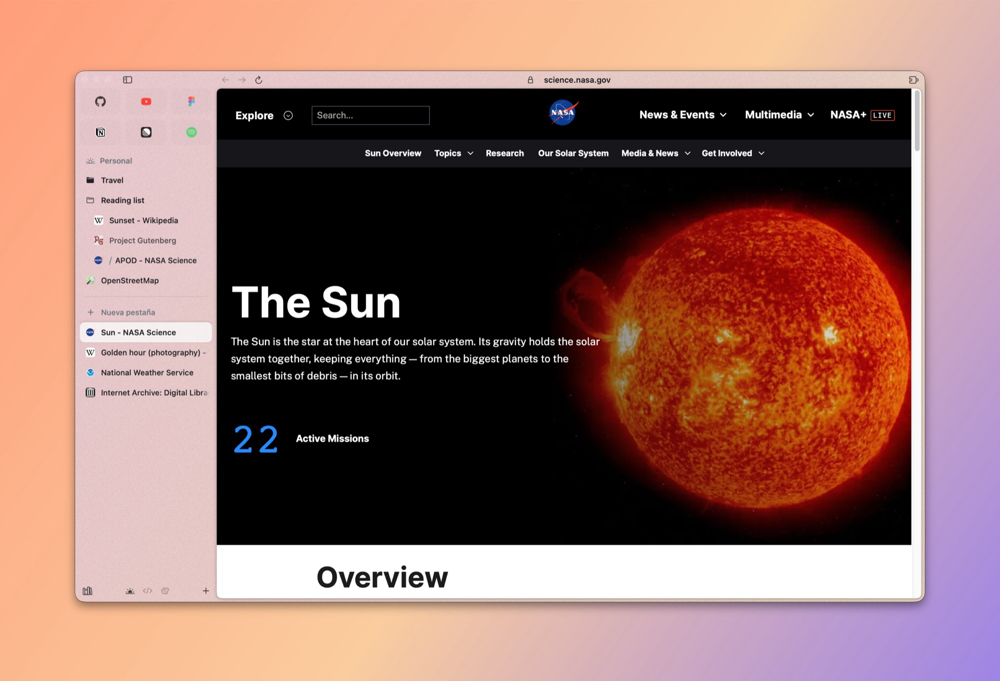
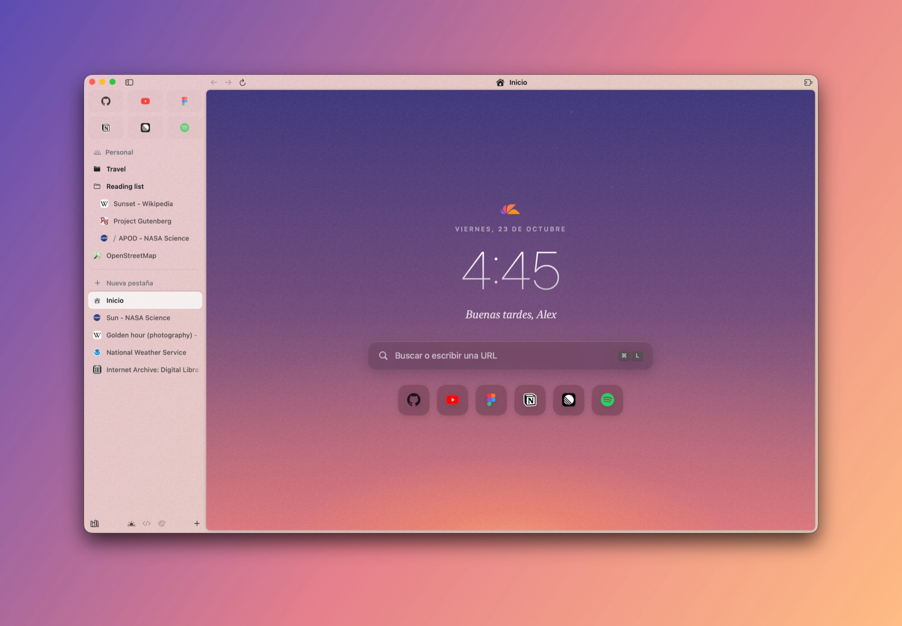
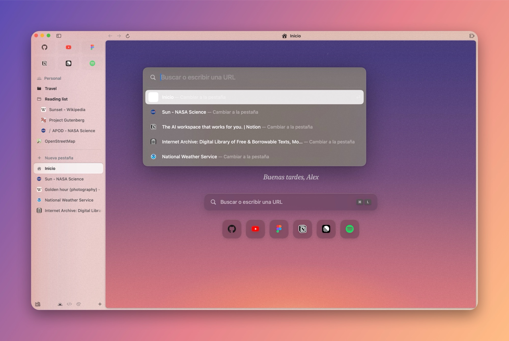
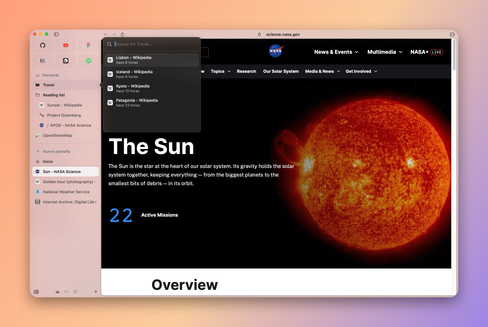
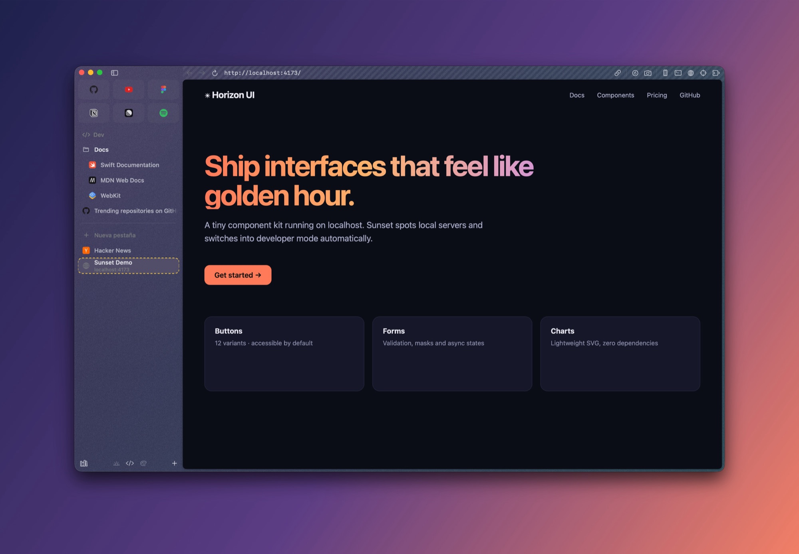

<div align="center">



# Sunset Browser

**A calm, fast, native macOS browser. The open-source home for people who love Arc.**

Spaces, pinned tabs, folders, a Command Bar and a sidebar that feels like Arc, built from scratch with Swift, SwiftUI, AppKit and WebKit.

[](https://github.com/CarlosVP120/sunset-browser/actions/workflows/ci.yml)
[](LICENSE)


[](CONTRIBUTING.md)

[Download](https://github.com/CarlosVP120/sunset-browser/releases/latest) ·
[Build from source](#build-from-source) ·
[Roadmap](#roadmap) ·
[Contributing](CONTRIBUTING.md)

<br>



</div>

## Why Sunset?

Arc changed how many of us use the web, and then it stopped getting new features. Sunset is a community-owned answer: the ideas people loved about Arc, rebuilt as a small, native, open-source app that anyone can read, fix and extend.

- **Native and light.** Pure Swift on top of the system WebKit. No Electron, no bundled Chromium, no account required, and a fraction of the memory and disk of Chromium-based browsers.
- **Feels like Arc.** Spaces with their own colors, pinned tabs that remember their home, folders, favorites, a Command Bar and smooth animations everywhere.
- **Your data stays yours.** Everything is stored locally. Passwords are encrypted with a key kept in your Keychain. Nothing is sent anywhere.
- **Bring everything with you.** The first launch imports spaces, pinned tabs, folders, bookmarks, history, passwords and signed-in sessions from Arc, Chrome, Safari, Brave or Edge, without touching the original browser.

## Features

<table>
<tr>
<td width="50%"></td>
<td width="50%"></td>
</tr>
<tr>
<td valign="top"><b>A Home that follows the sun.</b> The sky changes with the time of day, from sunrise to golden hour to a starry night, with your clock, search and favorite apps.</td>
<td valign="top"><b>Command Bar (⌘T).</b> Search, open URLs, jump to any open tab and run browser actions without leaving the keyboard.</td>
</tr>
<tr>
<td width="50%"></td>
<td width="50%"></td>
</tr>
<tr>
<td valign="top"><b>Folders with previews.</b> Hover a folder to peek inside and search it. Drag and reorder everything: tabs, folders, favorites and spaces.</td>
<td valign="top"><b>Developer mode.</b> Turns on by itself on <code>localhost</code> (or press ⌃D anywhere): full URL, hard reload, responsive sizes and the native WebKit inspector, console and network panels.</td>
</tr>
</table>

**And more**

- **Spaces** with gradient themes, grain and light or dark appearance. Switch with ⌃1–⌃9 or by swiping two fingers on the sidebar.
- **Pinned tabs that behave like Arc's.** They keep their home URL; when you navigate away a `/` appears so you can jump back.
- **Today tabs** that close into an archive you can search and restore (⇧⌘T reopens the last one).
- **Library** with downloads, media and archived tabs.
- **Media controls** in the sidebar for whatever is playing in other tabs, plus Picture in Picture.
- **Protected video (DRM)** through FairPlay, the same system Safari uses, so streaming services that support Safari can play in Sunset.
- **Password manager** with autofill, encrypted locally with a Keychain key.
- **Web extensions** through WebKit's extension support.
- **Find in page, zoom and printing**, with the standard macOS shortcuts.

## Install

1. Download `Sunset-Browser.dmg` from the [latest release](https://github.com/CarlosVP120/sunset-browser/releases/latest).
2. Open it and drag **Sunset Browser** to **Applications**.
3. The first time, macOS may say it can't verify the developer (builds are not notarized yet). Open **System Settings › Privacy & Security** and click **Open Anyway**.

Requires macOS 14 Sonoma or later, on Apple silicon or Intel.

## Build from source

You need Xcode 26 or later (the app icon is an Icon Composer `.icon` file compiled with `actool`).

```bash
git clone https://github.com/CarlosVP120/sunset-browser.git
cd sunset-browser
./scripts/bundle.sh
open "build/Sunset Browser.app"
```

Other useful commands:

```bash
swift build                    # compile only
swift test                     # unit and snapshot tests
./scripts/bundle.sh release    # optimized build
./scripts/make-dmg.sh          # universal (Apple silicon + Intel) installer: build/Sunset-Browser.dmg
```

Handy environment variables while developing:

| Variable | Effect |
|---|---|
| `SUNSET_ONBOARDING=1` | Always show the first-launch onboarding |
| `SUNSET_HOUR=19.5` | Pretend it's that hour, to preview the Home sky |
| `SUNSET_USER_NAME=Alex` | Name used in the Home greeting |
| `SUNSET_BENCH=folders` | Run the sidebar animation benchmark and write `/tmp/sunset-bench.txt` |

## Keyboard shortcuts

| Shortcut | Action |
|---|---|
| ⌘T | Command Bar / new tab |
| ⌘L | Edit the current address |
| ⌘W | Close tab |
| ⇧⌘T | Reopen closed tab |
| ⌘D | Pin or unpin tab |
| ⌥⌘N | New folder |
| ⌃1 … ⌃9 | Switch space |
| ⌘S | Show or hide the sidebar |
| ⇧⌘C | Copy the current URL |
| ⌃⌘P | Picture in Picture |
| ⌃D | Toggle developer mode |
| ⌥⌘J · ⌥⌘E · ⌥⌘C | Console · network panel · inspect element |
| ⇧⌘M | Responsive (mobile) view |
| ⌘/ | All shortcuts |

## Architecture

Sunset is a Swift package split into small modules, each with one job:

| Module | What it contains |
|---|---|
| `BrowserEngine` | The `WebEngine` / `WebPage` protocols and the WebKit implementation: downloads, passwords, extensions and injected scripts |
| `BrowserCore` | The model: `Browser`, `Space`, `BrowserTab`, folders, history, commands and persistence |
| `BrowserUI` | Shared design system: theme, glass, tooltips, native menus, favicons |
| `SidebarFeature` | The sidebar: an AppKit `NSTableView` list for smooth animations, drag and drop, spaces |
| `ToolbarFeature` | Address bar, navigation and developer tools |
| `CommandBarFeature` | The Command Bar |
| `HomeFeature` | Home page and its dynamic sky |
| `LibraryFeature` | Downloads, media and archive |
| `ExtensionsFeature` | Extension toolbar and management |
| `BrowserImport` | Readers for Arc, Chromium browsers and Safari |
| `OnboardingFeature` | First-launch welcome and migration |
| `MiNavegador` | The app target: windows, menus and wiring |

The engine sits behind a protocol, so a Chromium engine (for example through CEF) could be added later without touching the rest of the app.

> **Naming note:** the project started as *MiNavegador* ("my browser" in Spanish). The package, the app target and the data folder still use that name, and the bundle identifier is `com.carlosvp.minavegador`, so existing installs keep their data. They will be renamed together with a data migration. Many code comments are still in Spanish too; please write new code comments and docs in English.

## Roadmap

- [ ] **English localization.** The interface is currently in Spanish. English, with String Catalogs ready for other languages, is the top priority.
- [ ] Signed and notarized releases, with automatic updates.
- [ ] Passkeys (needs Apple's `com.apple.developer.web-browser.public-key-credential` entitlement on an official build).
- [ ] Split view, quick windows and link previews.
- [ ] Sync between Macs.
- [ ] Profiles UI and per-space profiles.
- [ ] Optional Chromium engine.

Have an idea? [Open a feature request](https://github.com/CarlosVP120/sunset-browser/issues/new/choose) or start a [discussion](https://github.com/CarlosVP120/sunset-browser/discussions).

## Contributing

Contributions of every size are welcome: bug reports, translations, design polish and code. Read the [contributing guide](CONTRIBUTING.md) to set up the project, and look for issues labeled [`good first issue`](https://github.com/CarlosVP120/sunset-browser/labels/good%20first%20issue).

Please follow the [Code of Conduct](CODE_OF_CONDUCT.md). To report a vulnerability, see the [security policy](SECURITY.md).

## License

Sunset Browser is licensed under the [Mozilla Public License 2.0](LICENSE).

Sunset is an independent project. It is not affiliated with, endorsed by or connected to The Browser Company. "Arc" is a trademark of its owner and is mentioned only to describe inspiration and import compatibility. No code or assets from Arc are used.

Screenshots show public websites (NASA, Wikipedia and others) for illustration only; their content belongs to their owners.
